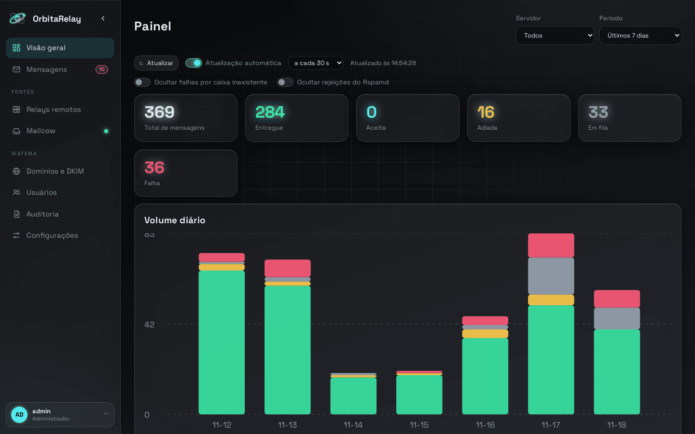
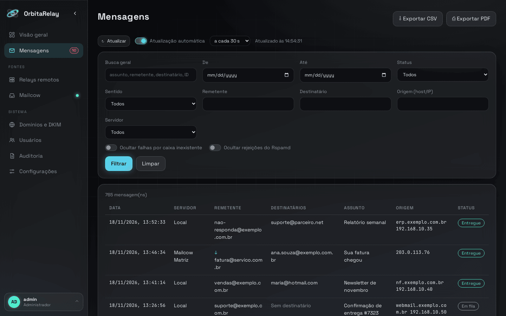
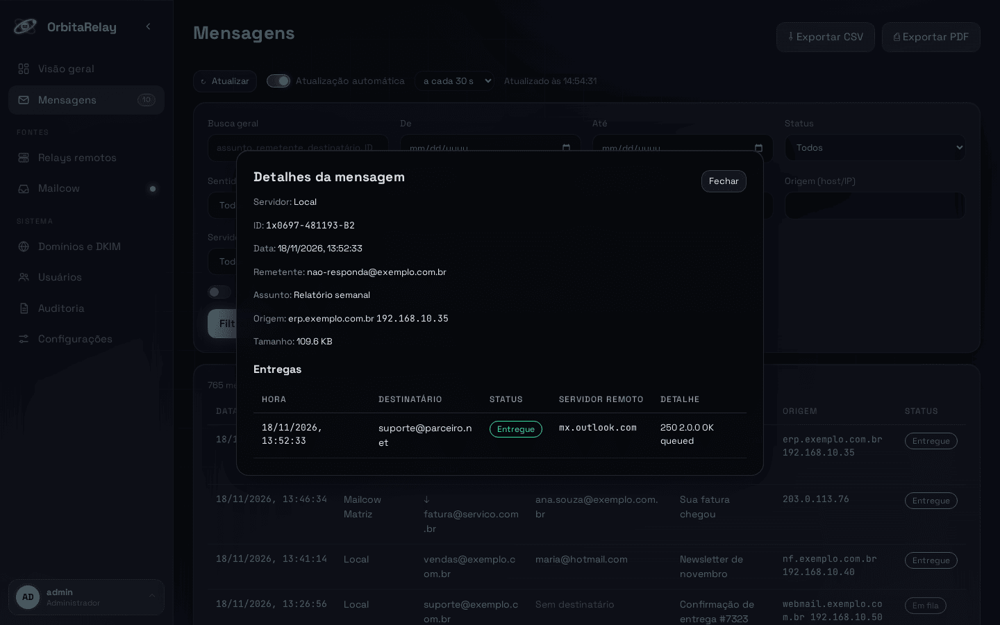
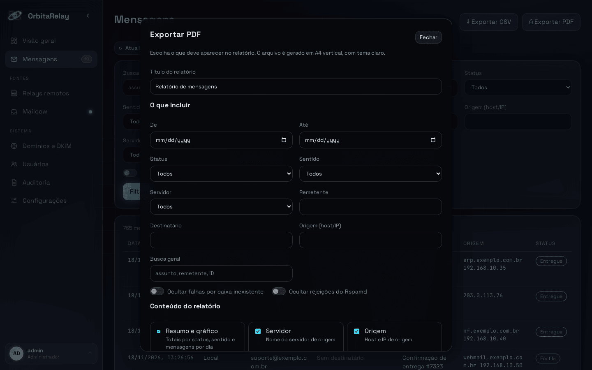
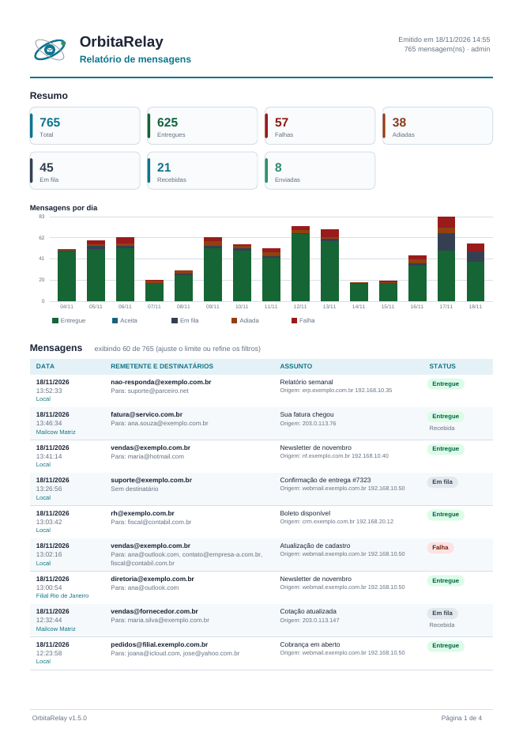

# Mensagens e relatórios

## Visão geral (Painel)

O painel mostra os totais por status e o **volume diário** em um gráfico empilhado, com filtro por **servidor** (no modo central ou com Mailcow) e por **período** (1, 7, 30, 90 ou 365 dias). Mensagens e Painel **se atualizam sozinhos** (a cada 15, 30, 60 ou 120 s) enquanto a aba está visível; há uma chave para ligar e desligar e o botão **Atualizar** para buscar na hora. A preferência fica salva no navegador.

### Status das mensagens

| Status | Significado |
|---|---|
| **Entregue** | O servidor de destino aceitou a mensagem. |
| **Falha** | A entrega falhou de forma definitiva (por exemplo, caixa inexistente ou rejeição). |
| **Adiada** | A entrega foi adiada e o servidor tentará de novo. |
| **Em fila** | Ainda aguardando entrega. |
| **Aceita** | (Mailcow) O Rspamd aceitou a mensagem, mas o log de entrega do Postfix já não está disponível. |

O menu lateral mostra, ao lado de **Mensagens**, o número de falhas de hoje.

## Mensagens

Lista com **filtros** por busca geral, período, status, sentido (recebidas ou enviadas), remetente, destinatário, origem (host ou IP) e servidor. Clique em uma linha para ver o **detalhe**, com cada tentativa de entrega (hora, destinatário, resultado, servidor remoto e resposta).

Campos vazios são mostrados como **Sem remetente**, **Sem assunto**, **Sem destinatário** e **Sem origem**.

## Exportar CSV e PDF

Os botões **Exportar CSV** e **Exportar PDF** abrem uma janela com os **mesmos filtros**, para você não exportar tudo.

- **CSV**: escolha os filtros e a ordem. As colunas são Data/Hora, Servidor, Direção, ID, Remetente, Destinatários, Assunto, Status, Host de origem, IP de origem e Tamanho.
- **PDF**: além dos filtros, escolha o **título**, se inclui **resumo e gráfico**, as colunas extras (Servidor, Origem, Tamanho, ID), a **ordem** e o **limite** de mensagens (até 10.000).

O PDF sai em **A4 vertical, tema claro**, com o logo do sistema, resumo por status e sentido, gráfico por dia, rodapé com número de página e a lista de filtros aplicados. Textos longos quebram linha em vez de serem cortados.

## Ocultar falhas

Em **Mensagens**, no **Painel** e nas janelas de exportação há duas chaves:

- **Ocultar falhas por caixa inexistente**: esconde mensagens que falharam só porque o destinatário não existe (respostas como `550 5.1.1`, "user unknown", "mailbox unavailable").
- **Ocultar rejeições do Rspamd** (aparece com servidores Mailcow): esconde as mensagens barradas como spam.

Só são ocultadas as mensagens em que **todas** as falhas são desse tipo e que **não foram entregues** a nenhum outro destinatário. Os dados **não são apagados**: basta desligar a chave para ver tudo. A lista mostra quantas mensagens estão ocultas, e o PDF registra o filtro aplicado. Para deixar ligado por padrão, use **Configurações > Logs e retenção**.

## Retenção

Mensagens mais antigas que o período de retenção (padrão 365 dias) são apagadas do banco automaticamente. O arquivo bruto de log do Exim também é rotacionado e compactado. Veja [Configurações](configuracao.md#logs-e-retenção).
