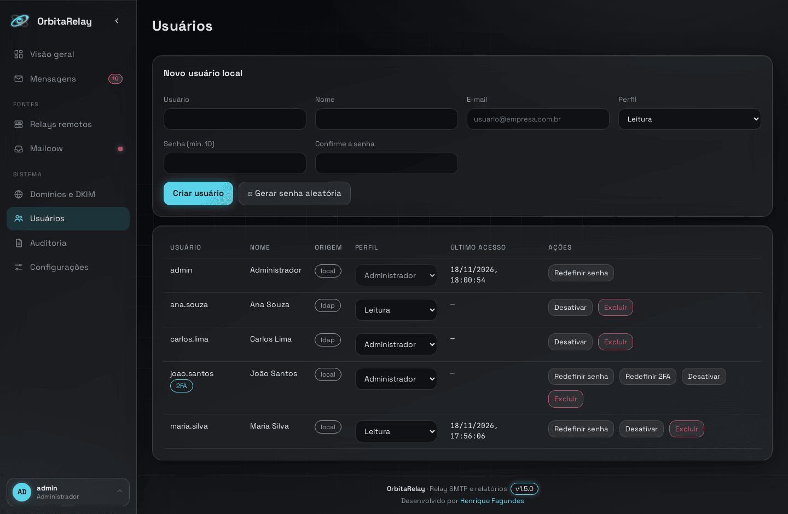
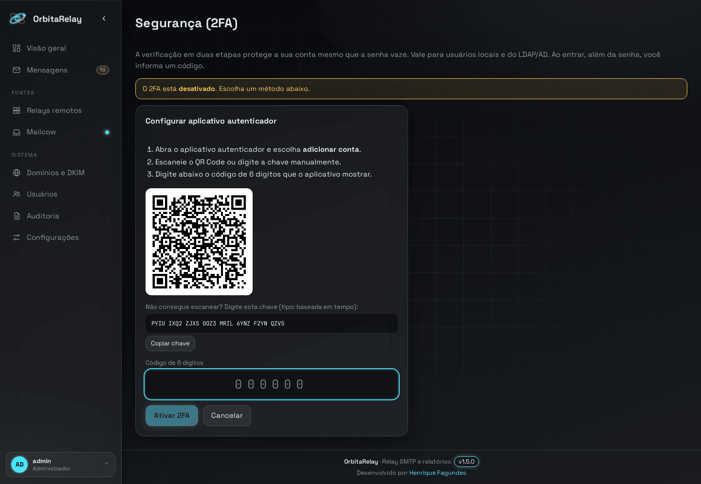
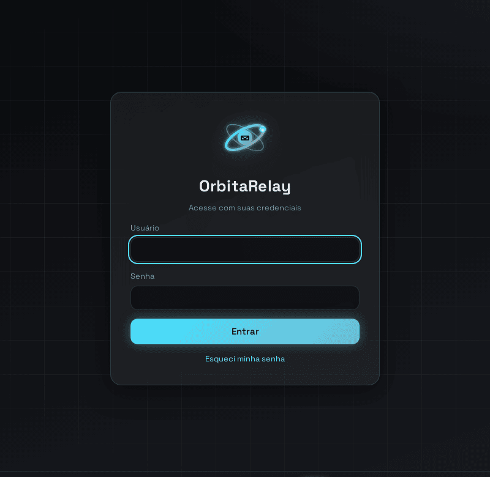
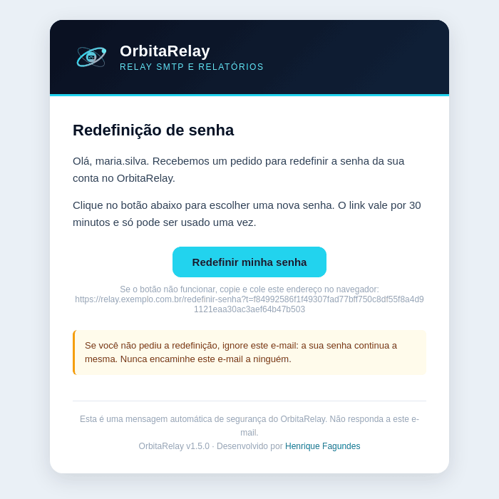
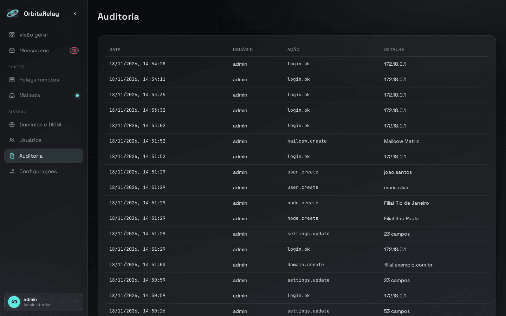

# Segurança

## Perfis de usuário

| Perfil | Acesso |
|---|---|
| **Administrador** | Tudo: Configurações, Usuários, Domínios, Mailcow, Relays remotos, Auditoria e assistente. |
| **Leitura** | Visão geral e Mensagens, exportação em CSV e PDF, e a própria conta (senha, e-mail e 2FA). |

Os usuários podem ser **locais** (criados no painel) ou vir do **LDAP/Active Directory** ([guia](ldap-ad.md)). Em **Usuários**, o administrador cria usuários locais, altera perfis, redefine senhas e 2FA, desativa e exclui.

### Criando um usuário local

- O **e-mail é obrigatório** e único por conta (a recuperação de senha depende dele).
- O botão **Gerar senha aleatória** cria uma senha de 16 caracteres só com letras maiúsculas, minúsculas e números, **já preenchendo a senha e a confirmação**, e mostra a senha com um botão para **copiá-la**.

## Autenticação em dois fatores (2FA)

Cada usuário, local ou do LDAP/AD, ativa o 2FA em **Segurança (2FA)** (menu do usuário, no rodapé do menu lateral).

### Métodos

- **Aplicativo autenticador** (recomendado): QR Code ou chave manual, compatível com Google Authenticator, Microsoft Authenticator, Authy, 1Password e Bitwarden (TOTP de 6 dígitos, 30 segundos).
- **Código por e-mail**: exige configurar o [E-mail do sistema](configuracao.md#e-mail-do-sistema-2fa). O código de 6 dígitos vale 10 minutos e vai **sempre para o e-mail cadastrado na conta**; o usuário não escolhe outro endereço.

### Códigos de recuperação

Ao ativar, são gerados **10 códigos de recuperação** de uso único, exibidos uma só vez (há botões para copiar e baixar). Eles substituem o código do aplicativo ou do e-mail se o acesso for perdido. Dá para gerar novos códigos (exige a senha e um código válido).

### No login

Depois da senha, o sistema pede o código. Há limite de tentativas (5 por verificação), e o mesmo código do aplicativo **não pode ser reutilizado**. Marque **Não pedir o código neste dispositivo por 30 dias** para confiar no navegador.

O dispositivo confiável é revogado ao desativar o 2FA, ao trocar ou redefinir a senha e pelo botão **Remover todos** em Segurança (2FA).

### Desativar e redefinir

- **Desativar o 2FA** não pede o código: abre uma confirmação avisando do risco e pede a senha (para usuários locais).
- O **administrador pode redefinir o 2FA** de um usuário em **Usuários** (por exemplo, se ele perdeu o celular e os códigos), com uma confirmação.

## Recuperação de senha

O link **Esqueci minha senha** aparece no login quando o [E-mail do sistema](configuracao.md#e-mail-do-sistema-2fa) e o **Endereço público do painel** estão configurados. Vale para **usuários locais com e-mail cadastrado**; usuários do LDAP/AD trocam a senha no diretório.

  
  

1. A pessoa informa o usuário ou o e-mail.
2. O sistema envia um e-mail com um **botão/link para redefinir a senha**, válido por **30 minutos** e de **uso único**.
3. O link abre a página para escolher a nova senha, com confirmação.

Por segurança, a resposta é sempre a mesma, exista ou não a conta, e há intervalo e limite de pedidos. Ao redefinir, **todas as sessões do usuário são encerradas** e, se a conta usa 2FA, ele continua sendo exigido no login. Um aviso de "senha alterada" vai para o e-mail da conta.

## Alterar o próprio e-mail

Usuários locais alteram o e-mail em **Minha conta**: informam o novo endereço e a senha atual e recebem, no **novo** e-mail, um botão de confirmação (link de 1 hora). Só depois do clique o e-mail da conta muda, e um aviso vai para o e-mail antigo. Cada e-mail só pode estar em uma conta.

## Proteções do relay

- **Proteção contra *open relay***: só as **redes autorizadas** podem enviar. Conexões que chegam com o IP do gateway do Docker (origem mascarada) são sempre recusadas ([entenda](docker-rede-ipv6.md#por-que-localhost-não-funciona)).
- **Restringir remetentes** aos domínios cadastrados (modo Relay).
- **Limites de tentativas**: login (10 por IP a cada 5 minutos), verificação do 2FA, recuperação de senha, coleta de servidores remotos.
- **Sessões** de 12 horas, em cookie `HttpOnly`, `SameSite=Strict` (e `Secure` atrás de HTTPS).

## Dados sensíveis

Segredos ficam **criptografados no banco** com AES-256-GCM, usando a chave `/data/master.key`: chaves DKIM privadas, senhas de SMTP e de smarthost, chaves de API do Mailcow e segredos do 2FA. **Faça backup do volume `app-data`**. Senhas de usuários locais são guardadas apenas como hash (bcrypt).

## Auditoria

Em **Auditoria**, o administrador vê o registro das ações: logins (com sucesso e com falha), alterações de configuração, criação e remoção de usuários, 2FA, domínios e chaves DKIM. Os registros mais antigos que um ano são apagados automaticamente.

